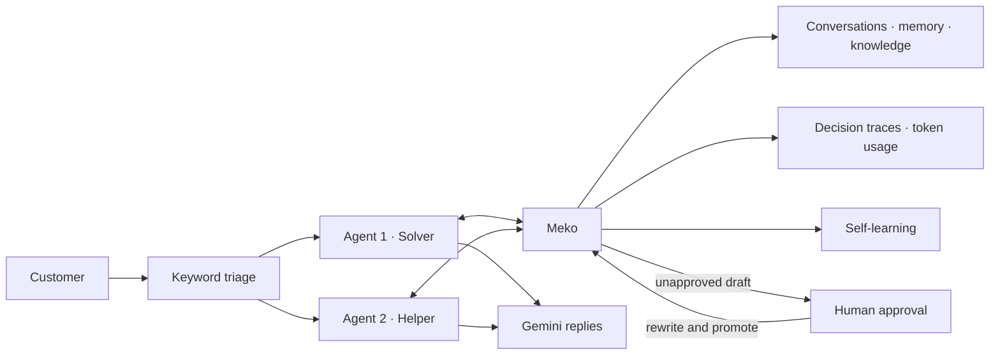

# SupportIQ — Never Solve It Twice

SupportIQ is a prototype customer-support dashboard and multi-agent workflow. It demonstrates how support agents can reuse verified answers, learn from new cases, and keep AI-generated suggestions separate from approved knowledge.

The project was created as a hackathon demo for a fictional e-commerce company, ShopEasy. Its central idea is simple: when a familiar issue comes in, retrieve a previously approved solution instead of solving the same problem from scratch. When there is no approved answer, generate a cautious suggestion, save it as an unapproved draft, and let a person review it before it becomes shared knowledge.

> **Prototype notice:** This project is intended for local development and demonstration, not production customer support. It has no user authentication or authorization, stores ticket history in a local JSONL file, and sends prompts to the configured external AI and Meko services. Do not submit real customer data or deploy it publicly without adding appropriate security, privacy, retention, and operational controls.

## What problem does it solve?

Support teams repeatedly encounter similar questions, while useful answers can remain trapped in individual conversations or be reused without verification. SupportIQ demonstrates a controlled knowledge-reuse loop:

- Search shared support context before generating a new answer.
- Clearly distinguish approved knowledge from unapproved AI-generated drafts.
- Reuse a matching draft only as a suggestion that requires human review.
- Promote a reviewed draft into shared approved knowledge.
- Show how each ticket moved through triage, agent routing, memory search, and response generation.

The goal is not to let an AI silently turn its own output into policy. A human approval step separates newly generated suggestions from trusted answers.

## What the application does

The current dashboard has two pages:

- **Desk** submits a ticket, streams its decision ledger, and reopens the last eight saved cases.
- **Memory** lists drafts awaiting approval, promoted records returned by Meko, searchable results, and sanitized self-learning signals.

The API also exposes benchmark fixtures, but the current dashboard does not include an Evidence page, a How it works page, or a guided-story control.

Ticket history is stored locally in the ignored `data/history.jsonl`. A benchmark run writes one aggregate result to the ignored `data/benchmark_results.json`; it does not enter `/api/metrics`.

## Architecture



## Where Meko is used

| Meko feature or tool | What it does here | Shown on |
|---|---|---|
| `context_search` | Finds shared context and candidate drafts for a ticket. | Desk |
| `knowledgebase_search` | Checks relevant approved knowledge when combined search misses it. | Desk |
| `memory_add` | Saves a new suggestion as an unapproved draft. | Memory |
| `memory_update` | Rewrites an approved draft into a clean knowledge entry. | Memory |
| `memory_promote` | Promotes the reviewed entry into shared knowledge. | Memory |
| `conversation_create` | Creates ticket and approval conversations. | Desk |
| `conversation_add_message` | Records the ticket, answer, and decision trace. | Desk |
| `track_token_usage` | Records provider-reported use per model call when available. | Benchmark/API |
| `selflearning_status` | Returns learning status for the selected datapack. | Memory |
| `selflearning_shortfalls` | Reports returned learning shortfalls. | Memory |
| `selflearning_query_log` | Returns a query-log summary; raw queries and emails are stripped by the server. | Memory |
| `selflearning_verify` | Replays verification only after a person clicks Verify. | Memory |
| Datapacks | Keep demo and benchmark records in named, isolated datasets. | API |

## Technology

- **Python 3.10+** — application and agent implementation.
- **FastAPI** — HTTP API and dashboard backend.
- **Uvicorn** — local ASGI web server.
- **MCP Python SDK** (`mcp`) — connects to Meko's MCP service.
- **Meko** — shared datapack, context search, learned drafts, and promotion of approved memories.
- **Google Gen AI SDK** (`google-genai`) — Gemini-powered response generation.
- **python-dotenv** — loads local settings from `.env`.
- **HTML, CSS, and vanilla JavaScript** — single-file dashboard in `index.html`; fonts are loaded from Google Fonts.

Python dependencies are listed in [`requirements.txt`](./requirements.txt). The dashboard is served directly by FastAPI; there is no separate frontend build step.

## Motion

The dashboard uses short, state-triggered motion to make ticket intake, memory reuse, human approval, and agent activity easier to follow. Motion uses CSS and JavaScript only; it respects `prefers-reduced-motion`, pauses live indicators when the tab is hidden, and does not replay ticket or memory entrance effects on an unchanged refresh.

Run the headless browser check with `npm --prefix tests/motion install` followed by `npm --prefix tests/motion test`. It serves the dashboard with mocked Meko/Gemini responses, so no external keys are needed. The ticket-stream and approval recordings are written to `docs/motion-recordings/`.

## How the workflow works

1. **Receive a ticket.** A customer-support issue is submitted through the dashboard or API.
2. **Triage it.** The server classifies the issue into a category, short intent, and priority using keyword rules. Unmatched tickets use the `Other` / `normal` defaults.
3. **Choose a resolution agent.** The server assigns the request to the least-used running agent (Solver or Helper). An optional legacy API field can select one explicitly.
4. **Search shared context.** The agent queries the configured Meko datapack for approved knowledge and saved drafts. Approved results are checked for relevance.
5. **Choose a knowledge path:**
   - **Approved result found (`verified`):** generate a concise response grounded in approved context.
   - **Matching draft found (`draft_reused`):** reuse it as an unverified suggestion and flag the response for human review.
   - **No usable result (`new_draft_saved`):** generate cautious, generic troubleshooting guidance and save it to Meko as an unapproved draft.
6. **Review and promote.** A human can review a pending draft in the dashboard. Approval rewrites it into a knowledge-base entry and promotes it through Meko. Promotion is a one-way Meko operation.
7. **Inspect the trace.** Each ticket gets its own Meko conversation containing the ticket, reply, status, and workflow trace. Gemini token usage is tracked per call when the provider returns usage metadata; unknown usage is labeled rather than estimated.
8. **Run an isolated benchmark.** The repository includes 100 fictional knowledge entries and 60 benchmark tickets grouped into 20 draft → reuse → approval → verified flows. Use a fresh, isolated Meko datapack; never point the runner at a shared or production datapack.

### Approval flow in five sentences

1. A ticket with no relevant approved answer receives cautious guidance and a new Meko draft.
2. The draft stays unapproved and is listed on the Memory page with its returned author and time.
3. A person reviews the text and explicitly selects **Approve**.
4. SupportIQ rewrites the draft as a knowledge entry, updates it, then asks Meko to promote it.
5. A later ticket searches the shared datapack and can return a verified answer; promotion is one-way in this prototype.

The code includes [`support_knowledge_base.md`](./support_knowledge_base.md) as a fictional ShopEasy example. The benchmark baseline uses the complete 100-entry fixture in [`data/support_knowledge_base_100.json`](./data/support_knowledge_base_100.json). The app does not upload either file automatically; approved knowledge must already be available in the selected Meko datapack.

## Screenshots

Page captures are saved at 1440px in [`docs/screenshots/`](./docs/screenshots/):

- [Desk](./docs/screenshots/desk.png)
- [Memory](./docs/screenshots/memory.png)

## Measured benchmark results

**Pending.** No run from the new single-file benchmark format is stored yet. The `/api/benchmark/results` endpoint reads `data/benchmark_results.json` and reports measured results after the command in [Isolated benchmark setup](#isolated-benchmark-setup) is run. No benchmark values are estimated or prefilled.

## Requirements

Before running the app, you need:

- Python 3.10 or later.
- A Meko API key and access to a Meko datapack (the default name is `support-hackathon`).
- A Google Gemini API key with access to the configured model.
- Network access to the Meko and Google AI services.

## Configuration

Create a local `.env` file from the safe template:

```powershell
Copy-Item .env.example .env
```

Open `.env` in a text editor and set your own credentials:

```dotenv
MEKO_API_KEY=your_meko_api_key
GEMINI_API_KEY=your_gemini_api_key
GEMINI_MODEL=gemini-3.1-flash-lite
GEMINI_FALLBACK_MODEL=
DATAPACK_NAME=support-hackathon
```

`MEKO_API_KEY` and `GEMINI_API_KEY` are required for the full ticket workflow. The FastAPI dashboard can still start without a Meko connection, reports the failure, and retries on later requests. `GEMINI_MODEL` and `DATAPACK_NAME` have defaults shown above. `GEMINI_FALLBACK_MODEL` is optional and is tried after transient retries against the primary model. `DATAPACK_NAME` must match a datapack accessible to your Meko account.

The repository's `.gitignore` excludes `.env`. Keep the real keys in `.env`, never commit or paste them into source files, screenshots, issue reports, or chat. If a key has been exposed, revoke or rotate it with its provider.

## Run locally

### Windows PowerShell

From the repository folder:

```powershell
py -3 -m venv .venv
.\.venv\Scripts\python.exe -m pip install -r requirements.txt
Copy-Item .env.example .env
notepad .env
```

After adding your credentials and saving `.env`, start the dashboard:

```powershell
.\.venv\Scripts\python.exe server.py
```

### macOS or Linux

From the repository folder:

```bash
python3 -m venv .venv
source .venv/bin/activate
python -m pip install -r requirements.txt
cp .env.example .env
```

Edit `.env`, set your credentials, and start the dashboard:

```bash
python server.py
```

The server listens on `127.0.0.1:8000`. Open [http://localhost:8000](http://localhost:8000) in a browser. Stop it with `Ctrl+C`.

FastAPI's interactive API documentation is available at [http://localhost:8000/docs](http://localhost:8000/docs) while the server is running.

## API reference

All endpoints are served from the local FastAPI application.

| Method | Path | Purpose |
|---|---|---|
| `GET` | `/` | Serve the dashboard. |
| `GET` | `/api/health` | Report API, Meko, agent-count, model, LLM error count, ticket error rate, selected datapack name, and local history status. Does not return credentials. |
| `POST` | `/api/ticket` | Process one ticket and return its result and execution trace. |
| `POST` | `/api/ticket/stream` | Process one ticket and stream progress as Server-Sent Events. |
| `GET` | `/api/metrics` | Return persisted live ticket results and workflow errors. |
| `GET` | `/api/drafts` | Return unapproved memories currently listed from Meko. |
| `GET` | `/api/memory/lifecycle` | Return pending and promoted memory metadata without email fields. |
| `POST` | `/api/memory/search` | Search Meko shared context. |
| `POST` | `/api/approve` | Rewrite and promote a selected Meko draft. |
| `GET` | `/api/selflearning` | Return Meko self-learning signals with raw query text and email fields removed. |
| `POST` | `/api/selflearning/verify` | Replay a Meko search only when explicitly requested by the user. |
| `GET` | `/api/benchmark/results` | Return the one local aggregate benchmark result separately from live metrics. |
| `GET` | `/api/benchmark/fixtures` | Return the fictional benchmark tickets and demo-story fixtures. |

### Request examples

Submit a ticket:

```json
{
  "ticket": "My refund has not arrived."
}
```

Ticket text must contain 1–4000 characters. For backwards compatibility, `/api/ticket` also accepts an optional `agent` value of `agent1-solver` or `agent2-helper`; normally routing is automatic.

Search shared memory:

```json
{
  "query": "refund has not arrived"
}
```

Memory search accepts a query of 1–500 characters.

Approve a draft:

```json
{
  "id": "meko-memory-id",
  "text": "The draft text returned by the draft listing"
}
```

The server returns ticket details such as the assigned agent, triage category and priority, response, verification status, per-call token usage, Meko persistence status, memory-search information, and trace events. `/api/ticket/stream` emits `data:` events while processing, followed by a `complete` event containing the result, or an `error` event if processing fails.

## Command-line demo

[`scripts/demo_cli.py`](./scripts/demo_cli.py) demonstrates the knowledge lifecycle in a terminal: use existing approved knowledge, create a new draft, reuse a draft with a review flag, approve a draft, and query it again. It uses the same Meko and Gemini credentials as the web app:

```powershell
.\.venv\Scripts\python.exe -m scripts.demo_cli
```

On macOS or Linux, activate `.venv` first, then run `python -m scripts.demo_cli`. The demo can make persistent changes to your Meko datapack. Its optional `RESET=1` mode is refused unless `DATAPACK_NAME` contains `demo` or `benchmark` and `CONFIRM_RESET_DATAPACK` exactly matches that name.

### Isolated benchmark setup

Generate or refresh the checked-in fictional fixtures:

```powershell
.\.venv\Scripts\python.exe -m scripts.generate_benchmark_data
```

Create a new empty benchmark datapack (for the lifecycle workflow) or seed a separate demo datapack with 100 promoted fictional entries. Choose a new name if the exact name already exists:

```powershell
.\.venv\Scripts\python.exe -m scripts.create_demo_datapack --name supportiq-benchmark-2027-01-17 --confirm-name supportiq-benchmark-2027-01-17
.\.venv\Scripts\python.exe -m scripts.create_demo_datapack --name supportiq-demo-kb-2027-01-17 --confirm-name supportiq-demo-kb-2027-01-17 --seed-kb
```

The utility refuses an existing exact name and never deletes or resets another datapack. For the 60-case benchmark, use two PowerShell terminals. In Terminal 1, set the exact pack name and start SupportIQ:

```powershell
$env:DATAPACK_NAME = "supportiq-benchmark-2027-01-17"
.\.venv\Scripts\python.exe server.py
```

In Terminal 2, run all 20 fictional flows against the same confirmed datapack:

```powershell
$pack = "supportiq-benchmark-2027-01-17"
.\.venv\Scripts\python.exe -m scripts.run_benchmark --confirm-datapack $pack
```

The runner creates/promotes Meko memories and makes one extra full-knowledge-base Gemini reply call per ticket for a measured baseline; this can take several minutes and may incur provider usage. It writes one aggregate result to `data/benchmark_results.json`, separate from ignored `data/history.jsonl` and `/api/metrics`. The benchmark result file is local and is not committed.

Supporting diagnostics live in [`scripts/`](./scripts/) and are not required to start the dashboard. Inspect Meko tool schemas with `python -m scripts.inspect_tools` before invoking unfamiliar tools. Run the credential-prefix check before each push:

```powershell
.\.venv\Scripts\python.exe scripts/check_secrets.py
```

Install development dependencies and run the tests with:

```powershell
.\.venv\Scripts\python.exe -m pip install -r requirements-dev.txt
.\.venv\Scripts\python.exe -m pytest
```

## Repository layout

| File | Description |
|---|---|
| `server.py` | FastAPI application, ticket orchestration, HTTP API, and local server entry point. |
| `agents.py` | Shared Meko connection, Gemini calls, Solver/Helper agent behavior, and draft approval helpers. |
| `index.html` | Single-file web dashboard (markup, styling, and browser-side code). |
| `support_knowledge_base.md` | Fictional ShopEasy sample knowledge base; the measured benchmark baseline uses the 100-entry JSON fixture. |
| `scripts/demo_cli.py` | Terminal demo of approved knowledge, draft reuse, and human approval. |
| `scripts/` | Meko schema inspection, diagnostics, and developer utilities. |
| `requirements.txt` | Python package dependencies. |
| `requirements-dev.txt` | Pinned test and development dependencies. |
| `.env.example` | Safe template for required credentials and optional settings. |
| `data/support_knowledge_base_100.json` | 100 fictional, structured support-knowledge entries. |
| `data/benchmark_tickets.json` | 60 fictional tickets covering 20 draft/reuse/approval flows. |
| `data/demo_story_tickets.json` | Four ticket fixtures for the known/new/reworded/verified walkthrough. |
| `data/benchmark_results.json` | Ignored local aggregate output created by the benchmark runner; absent until a run completes. |
| `scripts/create_demo_datapack.py` | Safely create a new isolated Meko demo or benchmark datapack. |
| `scripts/run_benchmark.py` | Run the isolated 60-ticket workflow and write one aggregate JSON result. |
| `docs/DEMO_SCRIPT.md` | Timed walkthrough script under 4:30. |
| `docs/SUBMISSION_CHECKLIST.md` | Hackathon handoff and submission checklist. |
| `docs/screenshots/` | 1440px captures of the Desk and Memory pages. |
| `tests/` | Offline tests for fallback behavior, persistence, lifecycle redaction, usage totals, and fixture shape. |

## Troubleshooting

- **Meko unavailable:** the server still starts and reports the connection state; ticket and memory requests retry the Meko connection. Check `.env`, datapack access, and network connectivity.
- **Missing Gemini key or model access:** keyword triage still works, but resolution needs a working Gemini configuration.
- **Meko connection or datapack error:** verify the API key, account access, network connectivity, and that `DATAPACK_NAME` exactly matches an accessible datapack.
- **Gemini request error:** verify the API key, model access, network connectivity, and `GEMINI_MODEL`. The optional `GEMINI_FALLBACK_MODEL` is tried if the primary model remains unavailable after transient retries.
- **Port 8000 is already in use:** stop the other local process using that port before starting this server.
- **No drafts appear:** drafts are read from the configured Meko datapack; check that the correct datapack is selected and that it contains unapproved memories.
- **Ticket history unavailable:** check the `history_error` field from `/api/health` and the ignored `data/history.jsonl` file's permissions and format.
- **Benchmark results unavailable:** check the `error` field from `/api/benchmark/results` and the ignored `data/benchmark_results.json` file.
- **An answer needs review:** `draft_reused` and `new_draft_saved` are intentionally marked unverified; have a human review the draft before promoting it.

## Current limitations

- Ticket history is stored locally as JSONL, not in an encrypted database; apply appropriate file permissions and retention.
- The app does not implement login, user roles, or endpoint authorization.
- There is no durable ticket database or implemented escalation workflow.
- Meko integration supports searching shared context and listing drafts, but not a full approved-memory catalogue endpoint.
- Human approval promotes knowledge in Meko and is not an undoable action through this app.
- The app depends on external Meko and Google Gemini services and requires valid credentials and network access.

## Security and privacy

Treat API keys and ticket contents as sensitive. The server binds to loopback (`127.0.0.1`) for local use, but the prototype has no authentication or authorization. Do not expose it to a network or use it with real customer data as-is. Before any production use, add authentication and authorization, secure secret management, appropriate data handling and retention, durable storage, monitoring, and deployment hardening.

## License

No license is currently specified in this repository. Contact the project owner before redistributing or reusing it.
