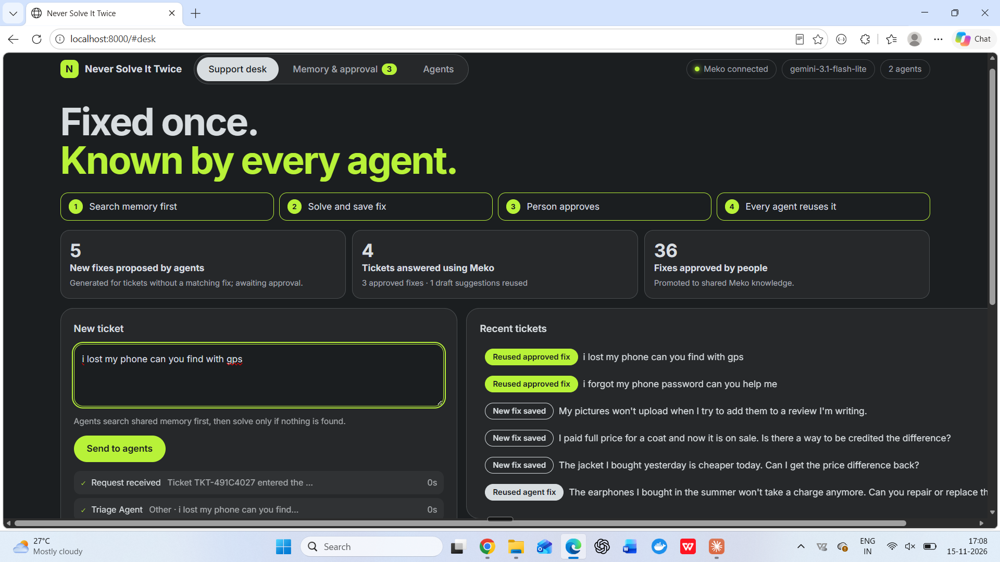
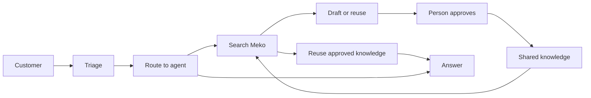

# SupportIQ

SupportIQ is a shared-memory support desk for two agents that search Meko before answering, save new fixes as drafts, and reuse a fix only after a person approves it.



- Search memory first.
- Solve and save a draft.
- A person approves the draft, and every agent reuses it.

Demo video: `TODO: add link before submitting`

## Why this exists

Support agents often re-solve the same issue, and AI-generated suggestions can be mistaken for approved policy. SupportIQ keeps those paths separate: Meko holds the shared context, the app marks suggested answers clearly, and human approval determines what becomes reusable knowledge.

This addresses three hackathon pains: retrieval quality, by searching Meko and a direct knowledge search before answering; context silos, by giving both agents the same datapack; and infrastructure sprawl, by keeping search, memories, conversations, usage records, and self-learning signals in Meko.

## How it works



A ticket is classified locally before routing. The server assigns it to whichever agent has handled fewer tickets; both agents use the same code and Meko datapack. The selected agent searches Meko for approved knowledge and unapproved drafts. Approved knowledge produces a verified answer, while an unapproved draft produces a flagged reuse or is saved as a new draft if no useful match exists. On the Memory page, a person reviews the draft and selects Approve. Approval rewrites the draft into a clean knowledge entry, updates it in Meko, and promotes it. Approving is permanent in Meko and cannot be undone from this app.

## The three pages

| Page | What it shows | Real data feeds |
|---|---|---|
| [Support desk](./docs/screenshots/desk.png) | Submit a ticket, watch the streamed workflow, and review recent outcomes. | `/api/ticket/stream`, `/api/metrics`, `/api/health`, and the local JSONL history. |
| [Memory and approval](./docs/screenshots/memory.png) | Review unapproved drafts, approve one, and inspect promoted memories. | Meko `memory_get_all` results for promoted and unpromoted memories. |
| [Agents](./docs/screenshots/agents.png) | Show each agent's handled-ticket and memory-reuse counts. | Counts derived from local ticket history plus each running agent's name. |

## Where Meko is used

| Meko tool | What it does here | Where to see it |
|---|---|---|
| `conversation_create` | Opens setup, agent, ticket, and approval conversations. | Server startup and ticket trace |
| `datapack_list` | Finds the configured named datapack. | Server startup |
| `datapack_create` | Creates a new isolated datapack. | `scripts/create_demo_datapack.py` |
| `context_search` | Searches the datapack for approved knowledge and draft memories. | Support desk and memory search |
| `knowledgebase_search` | Falls back to a direct approved-knowledge search. | Support desk ticket trace |
| `memory_add` | Saves a new solution as an unapproved draft. | Support desk new-ticket result |
| `memory_get_all` | Lists unapproved drafts and promoted memories. | Memory and approval |
| `memory_update` | Rewrites an approved draft as a clean knowledge entry. | Memory and approval |
| `memory_promote` | Permanently promotes a draft into shared knowledge. | Memory and approval |
| `memory_delete_all` | Clears learned drafts only in the explicit reset mode of the CLI demo. | `scripts/demo_cli.py` |
| `conversation_add_message` | Records ticket replies and approval rewrites in Meko conversations. | Ticket processing and approval |
| `track_token_usage` | Records provider-reported Gemini usage when the provider returns it. | Meko conversation records |
| `selflearning_status` | Reads self-learning status for the selected datapack. | Memory and approval API |
| `selflearning_query_log` | Reads a recent query-log summary. | Memory and approval API |
| `selflearning_shortfalls` | Reads learning shortfalls for configured steps. | Memory and approval API |
| `selflearning_verify` | Replays an explicit verification request for a log ID. | Memory and approval API |

`conversation_create`, `datapack_create`, and `conversation_add_message` are also called by setup and benchmark utilities. The app does not call tools outside this list.

## How this maps to the judging criteria

| Criterion | Concrete evidence |
|---|---|
| Use of Meko | The shared datapack search, draft memory, approved promotion, conversations, usage tracking, and self-learning calls are implemented in [`agents.py`](./agents.py). |
| Impact | The workflow gives a repeat ticket a verified or flagged path instead of silently solving it again; the four-ticket fixtures are in [`data/demo_story_tickets.json`](./data/demo_story_tickets.json). |
| Technical execution | FastAPI orchestration and streaming are in [`server.py`](./server.py); the single-file UI is [`index.html`](./index.html); tests cover server, agent, and benchmark behavior in [`tests/`](./tests/). |
| Innovation | The app separates unapproved drafts from promoted knowledge and requires an explicit rewrite-and-promote approval step. |
| Presentation | The three screenshots and the demo script [`docs/DEMO_SCRIPT.md`](./docs/DEMO_SCRIPT.md) show the actual workflow. |

## Quick start on Windows

The GitHub Actions workflow tests Python 3.10 and 3.14. Use 3.10 or 3.14.

Command Prompt:

```bat
py -3.10 -m venv .venv
.venv\Scripts\activate.bat
python -m pip install -r requirements.txt
copy .env.example .env
python server.py
```

PowerShell:

```powershell
py -3.10 -m venv .venv
.\.venv\Scripts\Activate.ps1
python -m pip install -r requirements.txt
Copy-Item .env.example .env
python server.py
```

Open [http://localhost:8000](http://localhost:8000) after the server starts.

Set these two required names in `.env`: `MEKO_API_KEY` and `GEMINI_API_KEY`. `GEMINI_MODEL` and `DATAPACK_NAME` are optional settings in [`.env.example`](./.env.example). Never commit or share `.env`; keys are never committed.

## Try the demo

Use a demo or benchmark datapack and the four fixtures in [`data/demo_story_tickets.json`](./data/demo_story_tickets.json).

| Step | Ticket fixture | Expected outcome |
|---|---|---|
| 1. Known issue | `The wallet balance is blank after signing in on a new phone.` | The seeded approved entry is expected to return `verified`. |
| 2. New issue | `A customer receives two return labels for one return request.` | No approved match or matching draft is expected, so the agent saves `new_draft_saved`. |
| 3. Reworded repeat | `The return page created a second label for the same package.` | After Meko indexes the draft, a reworded match should return `draft_reused` and need review. |
| 4. Approved repeat | `I still need help because my single return request has two shipping labels.` | Approve the draft in Memory and wait about 10 seconds for Meko to index it, then expect `verified`. |

Routing is least-used-agent routing, so which agent handles each fixture can vary. Meko indexing can take longer than 10 seconds. If a repeated ticket is not found, resubmit it after indexing or inspect the actual status in the ticket trace.

## Tests and checks

Run the Python suite:

```powershell
python -m pytest
```

Check tracked and staged files for common credential prefixes:

```powershell
python scripts/check_secrets.py
```

The motion check is documented in [`tests/motion/package.json`](./tests/motion/package.json). It uses Playwright with mocked Meko and Gemini responses:

```powershell
npm --prefix tests/motion install
npm --prefix tests/motion test
```

GitHub Actions workflow [`.github/workflows/tests.yml`](./.github/workflows/tests.yml) runs on pushes and pull requests. It tests Python 3.10 and 3.14, compiles the Python sources, runs `python -m pytest -q`, and runs `python scripts/check_secrets.py`.

## Benchmark

The benchmark measures 60 fictional tickets across 20 lifecycle groups. It compares the Meko-backed workflow with a measured full-knowledge-base Gemini reply, and records retrieval hit rate, reuse rate, false-reuse rate, latency, and token totals. A knowledge fixture contains 100 entries.

Create a fresh isolated datapack:

```powershell
python -m scripts.create_demo_datapack --name supportiq-benchmark-2026 --confirm-name supportiq-benchmark-2026
python -m scripts.create_demo_datapack --name supportiq-demo-kb-2026 --confirm-name supportiq-demo-kb-2026 --seed-kb
```

The benchmark script refuses a datapack unless the running app's `DATAPACK_NAME` exactly matches `--confirm-datapack`. Use the new empty or benchmark datapack with Meko connected:

```powershell
$env:DATAPACK_NAME = "supportiq-benchmark-2026"
python server.py
```

In a second terminal, run the benchmark:

```powershell
python -m scripts.run_benchmark --confirm-datapack supportiq-benchmark-2026
```

The runner accepts `--base-url`, `--confirm-datapack`, and `--limit-groups 1-20`; `--confirm-datapack` is required. It writes one aggregate benchmark-results JSON file, which is git-ignored.

Benchmark not run yet.

## Limitations

- Both agents run the same `SupportAgent` code. Tickets go to whichever agent has handled fewer, so the Agents page shows assignment and reuse activity, not skill.
- All displayed support content is fictional. The data and knowledge fixtures are demonstration data, not real policy.
- The workflow uses one configured Gemini model, with an optional fallback model. Meko and Gemini behavior is not a local simulation.
- Meko search and Gemini model calls dominate the 15 to 30 second ticket time. SupportIQ does not claim to make tickets faster.
- A new draft needs a short index wait, and the code waits 6 seconds after saving before continuing.
- Reworded tickets can be missed or wrongly matched. Meko results and the model's same-problem check both affect the outcome.
- Approvals cannot be undone from the app; promotion is permanent in Meko.
- The "approved" count comes from Meko's promoted memories and can include seeded demo entries.
- The app has no authentication or authorization, and ticket history is stored in a local ignored JSONL file.
- Live Meko and Gemini behavior cannot be verified without service keys and network access.

## Troubleshooting

- **Meko is unreachable or the key is wrong:** the server can start and display `Meko disconnected`. Ticket and memory requests retry or report the Meko failure. Check `MEKO_API_KEY`, datapack access, and network connectivity.
- **Gemini model not found or overloaded:** set `GEMINI_MODEL` to a model available to the key. `GEMINI_FALLBACK_MODEL` can provide a fallback after retry.
- **Port already in use:** stop the process using port 8000, then run `python server.py` again.
- **Virtual environment activation is blocked:** in an elevated PowerShell, run `Set-ExecutionPolicy -Scope Process -ExecutionPolicy Bypass`, activate the environment, then open a new shell if needed.
- **Approved entry is not immediately searchable:** wait about 10 seconds and retry the reworded ticket.

## Project structure

```text
agents.py                         Shared Meko connection and support-agent workflow
server.py                         FastAPI server, routing, APIs, and local history
index.html                        Three-page dashboard and browser JavaScript
requirements.txt                  Runtime Python dependencies
requirements-dev.txt              Test dependencies
.env.example                      Safe key-name template
data/
  demo_story_tickets.json         Four-ticket demonstration story
  benchmark_tickets.json          60 benchmark fixtures
  support_knowledge_base_100.json 100 fictional knowledge entries
scripts/
  create_demo_datapack.py         Create an isolated demo or benchmark datapack
  run_benchmark.py                Run the 60-case benchmark
  generate_benchmark_data.py      Generate benchmark fixtures
  demo_cli.py                     Terminal lifecycle demo
  inspect_tools.py                List Meko tool names and input schemas
  check_secrets.py                Scan tracked and staged files for common key prefixes
tests/
  test_agents.py                  Agent behavior tests
  test_server.py                  Server behavior tests
  test_benchmark_data.py          Fixture shape tests
  test_benchmark_results.py       Benchmark result tests
  motion/check.cjs                Playwright motion check
docs/
  DEMO_SCRIPT.md                  Timed demo walkthrough
  screenshots/                    Support desk, memory, and agents captures
.github/workflows/tests.yml       Python and secret checks in CI
```

## Security

Keys live only in `.env`, and `.env` is excluded by [`.gitignore`](./.gitignore). Run `python scripts/check_secrets.py` before pushing. Never share a zip containing `.env`, `.git`, or `.venv`.

## Credits and license

SupportIQ uses Meko for shared memory and agent infrastructure, YugabyteDB for the hackathon platform context, and Gemini for generated support replies.

License: `TODO: choose a license`
